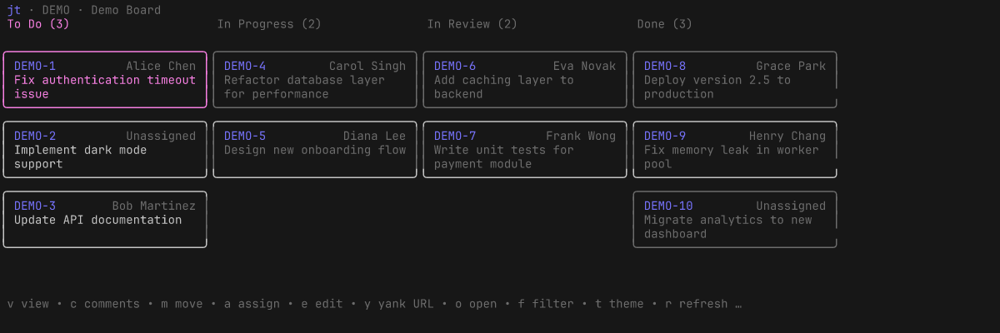
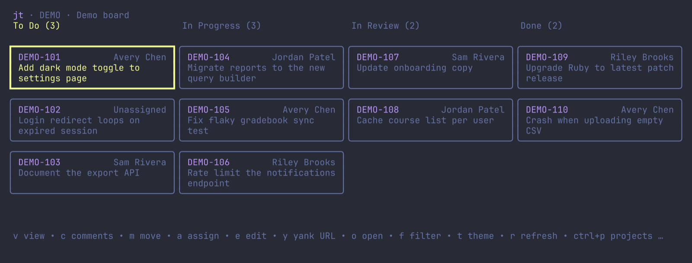
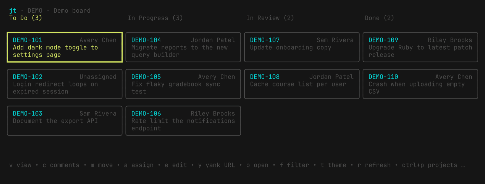
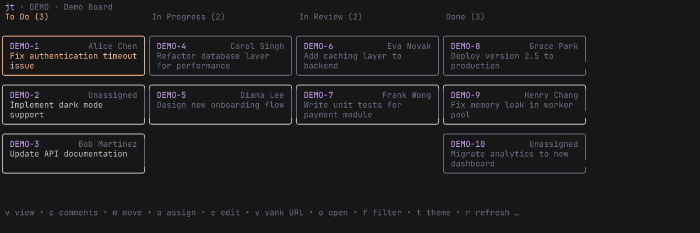
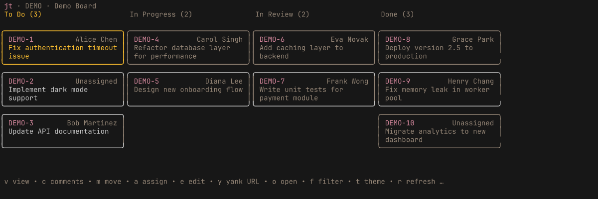

# jt

`jt` is a terminal kanban board for Jira. It shows the issues for a project as columns on a board, and lets you view, comment on, move, and reassign them without leaving the terminal.

`jt` has no config or login of its own. It reuses the configuration and credentials from [jira-cli](https://github.com/ankitpokhrel/jira-cli), so you need to set that up first.

## Built with

`jt` is a thin layer on top of other people's work, and it wouldn't exist without them. Thank you to:

- [jira-cli](https://github.com/ankitpokhrel/jira-cli) by Ankit Pokhrel, which `jt` imports as a library for all Jira access, config, and auth.
- [Bubble Tea](https://github.com/charmbracelet/bubbletea), [Lip Gloss](https://github.com/charmbracelet/lipgloss), [Bubbles](https://github.com/charmbracelet/bubbles), and [Glamour](https://github.com/charmbracelet/glamour) from Charm, which make up the terminal UI.

## Install

You need a working jira-cli setup. Follow the [jira-cli installation guide](https://github.com/ankitpokhrel/jira-cli#installation), then run `jira init` and follow the prompts.

### With Go

```sh
go install github.com/hawkbawk/jt@latest
```

### With Nix

```sh
nix run github:Hawkbawk/jt
```

To install it into your profile instead:

```sh
nix profile install github:Hawkbawk/jt
```

The flake is configured with a Cachix cache, so prebuilt binaries are available for x86_64-linux, aarch64-linux, and aarch64-darwin.

### From source

```sh
git clone git@github.com:Hawkbawk/jt.git
cd jt
go build -o jt .
```

## Run

After `jira init` has been run, start `jt` from any directory:

```sh
jt
```

`jt` opens the default project from your jira-cli config (`project.key`). If the configured `board.id` belongs to that project, `jt` uses it. Otherwise it picks a board for the project. Scrum boards show open sprints. Kanban boards show open work plus issues resolved in the last 14 days.

If your jira-cli config lives somewhere other than the default location, set `JIRA_CONFIG_FILE` to its path.

Press `ctrl-d` to quit immediately, or `ctrl-c` twice to confirm quitting.

## Settings

`jt` keeps its own settings in `jt.yaml` in your user config directory (`~/.config` on Linux, `~/Library/Application Support` on macOS). It creates the file the first time you run `jt`. Set `JT_CONFIG_FILE` to use a different path.

`jt` reads the file once at startup. If you edit it by hand, restart `jt` to pick up the change.

### Theme

Set `theme` to one of `terminal`, `charm`, `dracula`, `base16`, `catppuccin`, or `gruvbox`, or press `t` in `jt` to pick one. Picking a theme applies it right away and saves it to the settings file.

```yaml
theme: gruvbox
```

Each theme, with the same board:

**charm**



**dracula**



**base16**



**catppuccin**



**gruvbox**



The gruvbox theme uses the hard-contrast palette from [gruvbox.nvim](https://github.com/ellisonleao/gruvbox.nvim) by [ellisonleao](https://github.com/ellisonleao), which is based on the original [gruvbox](https://github.com/morhetz/gruvbox) by Pavel Pertsev (morhetz).

## Development

The Nix dev shell (loaded automatically if you use direnv) provides Go and the lint tools.

```sh
go build ./...
go test ./...
golangci-lint run
```
